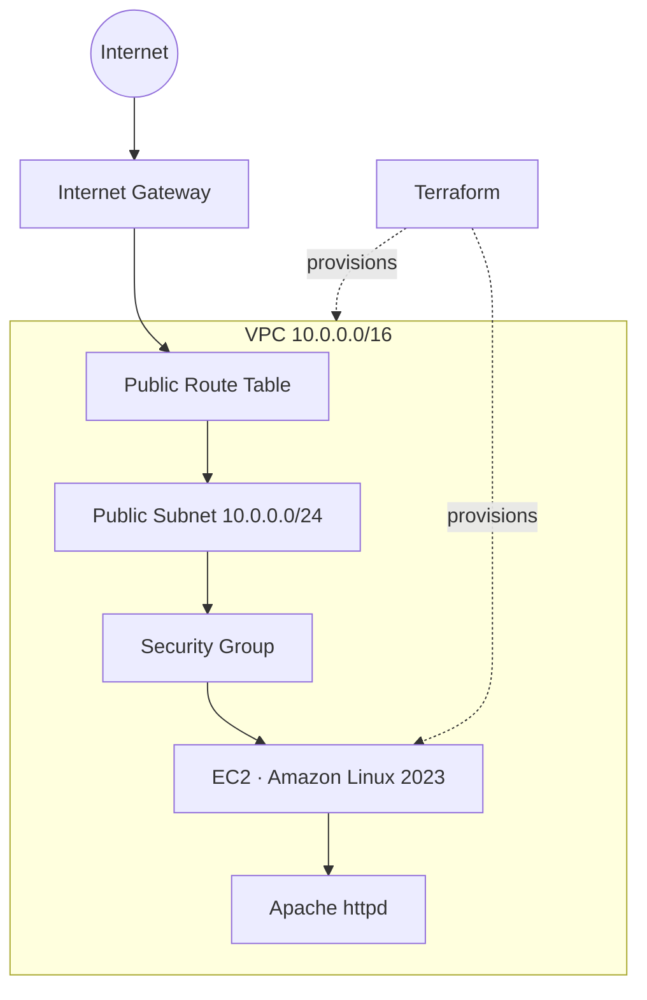

# AWS Web Server Infrastructure with Terraform

Provision a small public web server on AWS using **Terraform**. This project is an Infrastructure as Code (IaC) implementation of an AWS re/Start web-server challenge: it creates the network, configures access, launches an EC2 instance, and installs Apache through EC2 user data.

> **Scope:** This repository contains the Terraform implementation. The companion AWS CLI walkthrough is a separate, manual implementation of a similar lab; its CLI commands are not required to deploy this Terraform configuration.

## Overview

The configuration provisions the following resources:

- An Amazon VPC with CIDR block `10.0.0.0/16`.
- A public subnet with CIDR block `10.0.0.0/24`.
- An Internet Gateway and a route table with a default route to the internet.
- A route-table association for the public subnet.
- A security group with inbound HTTP (TCP/80), SSH (TCP/22), and outbound IPv4 traffic.
- An RSA SSH key pair registered in AWS.
- An EC2 instance using the latest matching Amazon Linux 2023 AMI in the selected region.
- An Apache HTTP server installed and started by `userdata.txt`.
- Local files containing the generated private SSH key and the instance's public IP address.

## Architecture



### Request flow

1. Terraform creates the VPC and public subnet.
2. The Internet Gateway and route table provide a route between the subnet and the internet.
3. The security group controls inbound HTTP and SSH access.
4. EC2 launches in the public subnet with a public IPv4 address.
5. The instance executes `userdata.txt` at launch to install and start Apache.
6. The web page is served from the instance over HTTP.

## Repository structure

```text
.
├── main.tf           # AWS network, security, key pair, EC2 and AMI data source
├── providers.tf      # Terraform and AWS provider requirements
├── variables.tf      # Region and EC2 instance type
├── terraform.tfvars  # Example variable values
├── userdata.txt      # EC2 bootstrap script (Apache installation)
├── index.html        # Web page content to publish on the instance
└── .gitignore        # Terraform state and generated/local files
```

## Prerequisites

- An AWS account with permission to create and manage the resources in this configuration.
- [AWS CLI](https://docs.aws.amazon.com/cli/latest/userguide/getting-started-install.html) installed and configured with credentials.
- [Terraform](https://developer.hashicorp.com/terraform/install) installed (the configuration declares Terraform `>= 1.2` and AWS provider `~> 6.0`).
- An SSH client, if you want to connect to the instance.

Configure credentials using an AWS-supported method, for example:

```bash
aws configure
aws sts get-caller-identity
```

Do not commit access keys, session tokens, private keys, or Terraform state files.

## Configuration

The current defaults are defined in `variables.tf` and `terraform.tfvars`:

| Variable | Default | Description |
|---|---|---|
| `region` | `us-west-2` | AWS region where resources are created |
| `instance_type_ec2` | `t3.micro` | EC2 instance type |

Edit `terraform.tfvars` or provide variables through another Terraform-supported mechanism to customize the deployment.

The AMI is selected dynamically using an AWS data source: the latest Amazon Linux 2023 x86-64 image published by Amazon in the configured region.

## Deploy

Run the following commands from the repository root.

### 1. Initialize Terraform

```bash
terraform init
```

### 2. Format and validate the configuration

```bash
terraform fmt -check -recursive
terraform validate
```

### 3. Review the execution plan

```bash
terraform plan -out=tfplan
```

Review the proposed resources, region, instance type, and network exposure before proceeding.

### 4. Apply the configuration

```bash
terraform apply tfplan
```

Terraform creates the infrastructure and writes two local files in the project directory:

- `labsuser.pem`: generated private key for SSH access.
- `public_ip.txt`: public IPv4 address assigned to the EC2 instance.

Keep the private key secure and restrict its permissions. The configuration sets its file permission to `0400`.

### 5. Open the web server

Read the instance's public IP:

```bash
cat public_ip.txt
```

Open the following address in a browser, replacing the placeholder with the IP:

```text
http://<EC2_PUBLIC_IP>
```

The instance bootstrap script installs and starts Apache. The repository also contains `index.html`; the current `userdata.txt` only installs and starts Apache, so the page content must be copied to the web root if you want to publish that custom page:

```bash
scp -i labsuser.pem index.html ec2-user@<EC2_PUBLIC_IP>:/tmp/index.html
ssh -i labsuser.pem ec2-user@<EC2_PUBLIC_IP> \
  'sudo install -m 0644 /tmp/index.html /var/www/html/index.html'
```

Amazon Linux 2023 uses the `ec2-user` account by default. Confirm that the instance has completed its initialization before connecting.

## Security considerations

This is a learning project, not a hardened production deployment. Review these settings before applying it in an account containing important workloads.

- **SSH is currently open to the internet.** The ingress rule in `main.tf` allows TCP/22 from `0.0.0.0/0`. Restrict this CIDR to your trusted public IP (or use a managed access method such as AWS Systems Manager) before deployment.
- **The private key is managed by Terraform.** The `tls_private_key` resource generates the key and `local_file` writes it locally. Private-key material is also stored in Terraform state. Treat state as sensitive, never commit it, and use encrypted, access-controlled remote state for shared environments.
- **HTTP is unencrypted.** Port 80 is suitable for this basic exercise. A real public service should use HTTPS and a certificate.
- **The instance receives a public IP.** Consider whether a public subnet and direct internet access are necessary for your use case.
- **Outbound traffic is unrestricted.** The current egress rule allows all IPv4 traffic.
- **AWS resources may incur charges.** Check current pricing for EC2 and related resources in your region.

The repository's security-group rules are intentionally described as implemented; the recommendations above do not mean those hardening changes have already been applied.

## Destroy the infrastructure

When you finish experimenting, remove the resources created by Terraform:

```bash
terraform destroy
```

Review the destruction plan and confirm it before proceeding. Keep any files you need before destroying the resources. Remove local generated credentials securely when they are no longer required.

## Troubleshooting

- **AWS credentials or access denied:** verify the active identity with `aws sts get-caller-identity` and check that it has the required permissions.
- **AMI not found:** confirm that the selected AWS region offers a matching Amazon Linux 2023 x86-64 AMI.
- **HTTP page does not load:** wait for EC2 user data to finish, verify the instance is running, and check the security-group rule and route to the Internet Gateway.
- **SSH connection fails:** confirm that the instance is ready, the private key corresponds to the registered key pair, and the inbound SSH rule allows your current public IP.

## Learning objectives

This project demonstrates:

- Declarative infrastructure provisioning with Terraform.
- AWS networking fundamentals: VPCs, subnets, Internet Gateways, and route tables.
- EC2 provisioning and bootstrapping with user data.
- Security-group configuration and SSH key-pair management.
- Parameterizing infrastructure by region and instance type.

## References

- [Terraform documentation](https://developer.hashicorp.com/terraform/docs)
- [AWS provider for Terraform](https://registry.terraform.io/providers/hashicorp/aws/latest/docs)
- [Amazon EC2 documentation](https://docs.aws.amazon.com/ec2/)
- [Amazon VPC documentation](https://docs.aws.amazon.com/vpc/)
- [AWS CLI documentation](https://docs.aws.amazon.com/cli/latest/userguide/)

---

Created by **Christian Badillo** as an AWS re/Start learning project.
